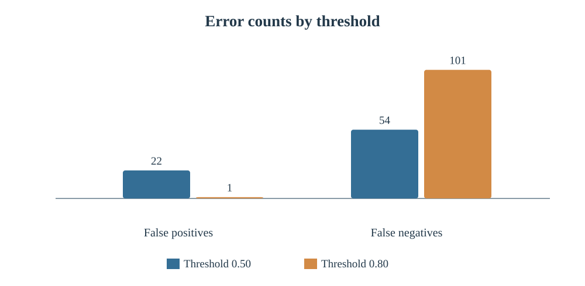
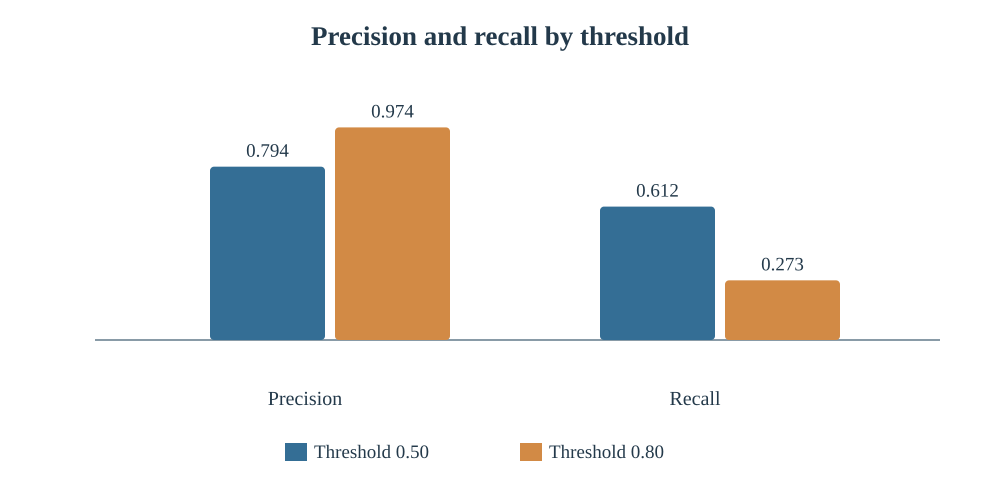

# How Strong Is the Assurance?
## Verification and the Limits of Independent AI Safety Evaluation

**Author:** Ishika Titar  
**Manuscript draft date:** 30 October 2026  
**Status:** Independent research manuscript (not peer-reviewed); proposed framework not empirically validated.

This project investigates the limits of independent assurance when the AI system evaluated for safety may differ from the system deployed. It focuses on two questions:

1. How can an auditor establish correspondence between an evaluated and deployed AI system?
2. How does uncertainty about model identity and deployment configuration affect which safety claims an independent evaluation can support?

The literature-based work organizes correspondence into five layers: **artifact, runtime, behavior, safeguards/configuration, and continuity**. It examines methods such as signed manifests, attestation, black-box checks, configuration review and monitoring, and proposes claim-specific reporting of what was verified and what remains unknown.

## At a glance

- **Question:** If an AI system was evaluated for safety, what evidence would an independent auditor need to show that the system users actually receive is the same one that was tested, and what can the auditor conclude when that evidence is incomplete?
- **Main conclusion:** An external evaluation can still give meaningful, scoped assurance about how the evaluation was designed. Claims that deployed safeguards work or that safety will persist need stronger evidence that the artifact, runtime, configuration and later changes match. Among the sources reviewed, none established full correspondence independently of the developer.
- **Biggest limitation:** This is a non-systematic literature synthesis. The five-layer framework and reporting statement are proposals that have not been tested; no real deployed system was audited.

### Research paper

[Read the complete paper (PDF)](Ishika_Titar_AI_Safety_Research_Paper_Final_Review%20(2).pdf)

### Supporting technical demonstration

The [experiment/](experiment/) folder contains a reproducible synthetic logistic-regression example comparing decision thresholds 0.50 and 0.80 on the same fitted model and test set. It illustrates how a downstream decision rule changes measured outcomes. **It is not an evaluation of a frontier AI system and does not validate the proposed five-layer framework.**

Run locally:

```bash
cd experiment
python -m pip install -r requirements.txt
python experiment.py
```

### Experiment figures





The study is a targeted, non-systematic synthesis. Framework ratings and relationships are analytical proposals, not measured certification results. The manuscript documents its scope, supporting references, limitations, and research process.
